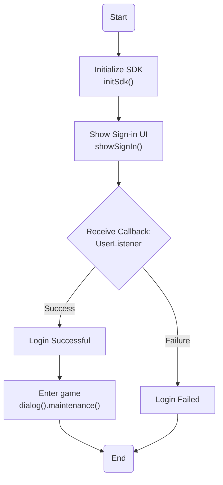

# NFsdk Integration Documentation (Android)

Sample project: `nfsdk-sample` — module `demo/` (`com.nfsdk.demo.MainActivity`) calls every public API and prints callbacks to an on-screen log.

## Table of Contents

- [Features](#features)
- [Tech](#tech)
- [Installation](#installation)
    - [1. Add NFsdk & Implement Dependencies](#1-add-nfsdk--implement-dependencies)
    - [2. Update Your AndroidManifest.xml](#2-update-your-androidmanifestxml)
    - [3. Update strings.xml Configuration](#3-update-stringsxml-configuration)
    - [4. nauth-services.json](#4-nauth-servicesjson)
- [Development](#development)
  - [1. Initialize NFsdk](#1-initialize-nfsdk)
  - [2. Authentication](#2-authentication)
    - [Login Interface](#login-interface)
    - [Login Callback](#login-callback)
    - [Verify user from the server](#verify-user-from-the-server)
    - [Logout](#logout)
    - [Notify Listener](#notify-listener)
    - [Maintenance](#maintenance)
  - [3. Payment Interface](#3-payment-interface)
  - [4. Tracking Interface](#4-tracking-interface)
  - [5. WebPage Interface](#5-webpage-interface)
- [Run the Sample](#run-the-sample)
- [Important Information](#important-information)

## Features

- Account management
- Google Play Billing payment (server-verified)
- Tracking via AppsFlyer & Firebase Analytics
- Crashlytics, Push Notifications via Firebase (FCM service declared by the SDK)
- Maintenance / announcement popups, external pages (fanpage, group, store, in-app review)

## Tech

- Java JDK 17+
- Gradle 8.14+ · Android Gradle Plugin 8.13.1
- android minSdk 24 · compileSdk 36 · targetSdk 35
- billing 8.x / 9.x (sample: 9.1.0)
- Pure Java (Java 1.8 source) — works with native, Unity, Cocos2d-x, Cocos Creator, Egret

## Installation
### **1. Add NFsdk & Implement Dependencies**
1. Copy `nfsdk-x.x.x.aar` to the app module's `libs` directory (Unity games: also copy `nfsdk-unity-x.x.x.aar`).
2. Copy `nauth-services.json` to the app's `assets` directory.
3. Copy `google-services.json` to the app module directory.

File configurations will be provided by the Operations team.

```sh
    ../app/libs/nfsdk-x.x.x.aar
    ../app/google-services.json
    ../app/src/main/assets/nauth-services.json
```

Root-level (project-level) Gradle file `<project>/build.gradle`

```gradle
plugins {
    id 'com.android.application' version '8.13.1' apply false
    id 'com.google.gms.google-services' version '4.4.2' apply false
    id 'com.google.firebase.crashlytics' version '3.0.2' apply false
}
```

Module (app-level) Gradle file `<project>/<app-module>/build.gradle`

```gradle
dependencies {
    implementation files('libs/nfsdk-x.x.x.aar')   // x.x.x is the version

    // REQUIRED — a bare .aar does not bring its own dependencies
    implementation 'androidx.webkit:webkit:1.12.1'
    implementation 'androidx.annotation:annotation:1.9.1'

    // Optional — a missing library only disables that feature, no crash.
    implementation 'com.android.billingclient:billing:9.1.0'                 // payment
    // appsflyer
    implementation 'com.appsflyer:af-android-sdk:6.18.1'
    implementation 'com.android.installreferrer:installreferrer:2.2'
    // facebook login — use a FIXED version, not latest.release
    implementation 'com.facebook.android:facebook-login:19.0.1'
    // google sign-in (Credential Manager)
    implementation 'androidx.credentials:credentials:1.6.0'
    implementation 'androidx.credentials:credentials-play-services-auth:1.5.0'
    implementation 'com.google.android.libraries.identity.googleid:googleid:1.1.1'
    // firebase
    implementation(platform("com.google.firebase:firebase-bom:34.15.0"))
    implementation("com.google.firebase:firebase-analytics")
    implementation("com.google.firebase:firebase-messaging")
    implementation("com.google.firebase:firebase-crashlytics")

    implementation 'androidx.browser:browser:1.8.0'                         // policy pages (Custom Tabs)
    implementation 'com.google.android.play:review:2.0.2'                   // PageType.REVIEW
}
```

### **2. Update Your AndroidManifest.xml**

The SDK manifest already declares (merged automatically): `INTERNET`, `ACCESS_NETWORK_STATE`, `com.android.vending.BILLING`,
the social-login activity, the web-payment activity and the FCM service (low priority — if the game has its own FCM service, the game's one is used).

The game only adds the Facebook meta-data:

```xml
<application
    android:allowBackup="false"
    tools:replace="android:allowBackup"
    ...>

    <meta-data android:name="com.facebook.sdk.ApplicationId"
        android:value="@string/facebook_app_id" />
    <meta-data android:name="com.facebook.sdk.ClientToken"
        android:value="@string/facebook_client_token" />
</application>
```

- AppsFlyer declares `android:allowBackup="true"`; if the game sets `false`, add `tools:replace="android:allowBackup"` (as in the sample).
- If the game uses `fullBackupContent` / `dataExtractionRules`, exclude the SDK session:
  `<exclude domain="sharedpref" path="com.nfsdk.sdk.xml"/>`.

### **3. Update strings.xml Configuration**
<b>Replace FACEBOOK_APP_ID and FACEBOOK_CLIENT_TOKEN with actual values:</b>
```xml
<resources>
    <string name="app_name">NFsdk Demo</string>

    <!-- Facebook App ID (Required for Facebook Login) -->
    <string name="facebook_app_id" translatable="false">FACEBOOK_APP_ID</string>

    <!-- Facebook Login Protocol Scheme: fb<facebook_app_id> -->
    <string name="fb_login_protocol_scheme" translatable="false">fbFACEBOOK_APP_ID</string>

    <!-- Facebook Client Token (Required for API Calls) -->
    <string name="facebook_client_token" translatable="false">FACEBOOK_CLIENT_TOKEN</string>
</resources>
```

### **4. nauth-services.json**

`app/src/main/assets/nauth-services.json`:

```json
{
  "client_id": "<product id from Operations>",
  "af_app_id": "<package name>",
  "af_dev_key": "<AppsFlyer dev key>",
  "sdk_language": "en",
  "show": ["fb", "gg", "quick"]
}
```

| Key | Description |
|---|---|
| `client_id` | Product id registered on the NFsdk server (**required**) |
| `af_dev_key` / `af_app_id` | AppsFlyer configuration |
| `sdk_language` | `en` / `vi`. Empty ⇒ **English** (the SDK does not follow the device language) |
| `show` | Login buttons: `fb` (Facebook), `gg` (Google), `quick` (guest) |

## **Development**



### **1. Initialize NFsdk**

- Loads remote configuration (retries, uses the cached copy), starts tracking, pre-loads the login UI. Non-blocking.
- Shows the floating 18+ label.
- Call **once** when the app starts.

```java
NFsdk.getInstance().initSdk(mainActivity);

// or, to receive the result ("success" / "fail"):
NFsdk.getInstance().initSdk(mainActivity, status -> {
    if ("success".equals(status)) NFsdk.getInstance().showSignIn(mainActivity, userListener);
});
```

### **2. Authentication**
#### **Login Interface**

- Session still valid ⇒ welcome screen, enters the game automatically after 3s.
- Otherwise ⇒ account picker / login form (or automatic guest login, depending on configuration).
- Safe to call repeatedly.

```java
NFsdk.getInstance().showSignIn(mActivity, userListener);
```

All listeners run on the **main thread, exactly once**. APIs can be called from any thread.

#### **Login Callback**

```java
UserListener userListener = new UserListener() {
    @Override
    public void onSignInInfo(String userId, String username, String name, String accessToken) {
        // Use userId to log in to the game
        // Use accessToken to verify the login on the game server
        gameVerifyUserLogin(accessToken);
    }
    @Override
    public void onSignOut() {
        // Back to the game's start screen
    }
    @Override
    public void onFail(int code, String message) { }
};
```

> `name` currently has the same value as `username`.

#### **Verify user from the server**

The game server verifies `accessToken` with the NFsdk server.

Endpoint:
```sh
GET https://api.newforcegame.com/internal/users/me
```
#### **Authorization:** choose either header or query string
- **Header:** `Authorization: ${accessToken}`
- **Query:** `authorization=${accessToken}`

Using **Header Authentication**:
```sh
curl -X GET "https://api.newforcegame.com/internal/users/me" \
     -H "Authorization: ${accessToken}"
```

Using **Query String Authentication**:
```sh
curl -X GET "https://api.newforcegame.com/internal/users/me?authorization=${accessToken}"
```

| Key          | Description                                                       |
|-------------|-------------------------------------------------------------------|
| `status`  | A status value of 0 indicates a successful request.                    |
| `data`.`id`    | Unique identifier for the user, used to log in to the game       |

#### **Logout**
```java
NFsdk.getInstance().logout(MainActivity.this);
// Logs out, sends onSignOut, then shows the account picker / login form again.
```

`onSignOut` is **also** called when the session ends inside the SDK: switch account / change password on the floating
user center, logout on the welcome screen, session expired, account deleted. The game only needs to handle `onSignOut`.

#### **Notify Listener**

```java
NFsdk.getInstance().setNotifyListener((type, data) -> {
    if (NFsdk.NOTIFY_LOGOUT.equals(type)) {
        // "logout", data = {userId}
    }
});
```

#### **Maintenance**

Checks server availability before letting the user enter the game. **Blocking**: under maintenance the SDK shows the
notice and the user cannot proceed. `onOpen` is called only when the server is open.

> 📌 **When to call:** when the user taps "Enter Game" after choosing a server.

```java
NFsdk.dialog().maintenance(MainActivity.this, () -> {
    // Server is open — continue the enter-game logic here.
});
```

Local maintenance switch (does not affect server maintenance): `NFsdk.getInstance().setMaintenance(true / false)` —
`false` also closes a local maintenance page that is open.

## **3. Payment Interface**

```java
ProductObject productObject = new ProductObject();
productObject.productId = "com.nfsdk.demo.pack1";
productObject.productName = "package 1";
productObject.orderId = gameOrderId;
productObject.amount = "25000";
productObject.serverId = "s1";
productObject.roleId = "1234567882";
productObject.extraInfo = "";

NFsdk.getInstance().payment(mActivity, productObject, new PaymentListener() {
    @Override
    public void onSuccess(String message) { }   // confirmed by the server
    @Override
    public void onFail(String message) { }      // error / cancelled / pending / web top-up opened
});
```

| Key           | Description                                       |
| ------------- | ------------------------------------------------- |
| `productId`   | Product ID as defined in Google Play Console      |
| `productName` | Name of the product                               |
| `orderId`     | **Unique transaction ID** generated by the game before the in-app purchase |
| `amount`      | Price of the package                              |
| `serverId`    | Server ID, useful for games with multiple servers |
| `roleId`      | User's role or ID in the game                     |
| `extraInfo`   | Additional information, customized as needed      |

- Callback is delivered **exactly once**. Order verification and retries are handled by the SDK and server.
- A purchase already in progress ⇒ the next call gets `onFail` immediately.

## **4. Tracking Interface**

```java
NFsdk.tracking()
```

| Function           | Description                                       |
| ------------- | ------------------------------------------------- |
| `createRole(String roleId)`   | Successful role creation      |
| `trackingStartTrial()` | Start trial |
| `tutorialCompleted()` | Player completes the newbie tutorial |
| `purchaseCheckOut()`     | Click on any in-game payment point |
| `paid(PaidType type)`    | Player successfully deposits money |
| `levelUp(int levelNumber)`      | Player reaches level `levelNumber` |
| `vipLevelUp(int levelNumber)`      | Player reaches VIP level `levelNumber` |
| `retention(int dayNumber)`      | Return on day `dayNumber` |
| `joinGuild()` | Join or create a guild |
| `stageComplete()` | Complete stage (default stage 1) |
| `stageComplete(int stageNumber)` | Complete stage `stageNumber` |
| `trackingEvent(String eventName)` | Custom event |
| `trackingEvent(String eventName, String json)` · `trackingEvent(String eventName, JSONObject json)` | Custom event with data |
| `getFcmToken(result)` | Read the FCM push token |
| `crashlytics()` | Crashlytics helper (e.g. `setUserId`) |

#### **PaidType**
| PaidType           | Description                                       |
| ------------- | ------------------------------------------------- |
| `PaidType.FIRST`   | First successful deposit / first gift package |
| `PaidType.WEEK` | First purchase of a week card |
| `PaidType.MONTH`      | First purchase of a month card |
| `PaidType.BATTLE_PASS`     | First purchase of a Battle Pass |

```java
try {
    NFsdk.tracking().createRole("roleid_123");
    NFsdk.tracking().tutorialCompleted();
    NFsdk.tracking().purchaseCheckOut();
    NFsdk.tracking().paid(PaidType.FIRST);
    NFsdk.tracking().levelUp(10);
    NFsdk.tracking().vipLevelUp(1);
    NFsdk.tracking().retention(1);
    NFsdk.tracking().joinGuild();
    NFsdk.tracking().stageComplete();
    NFsdk.tracking().stageComplete(2);

    // custom event
    NFsdk.tracking().trackingEvent("event_name");
    JSONObject j = new JSONObject();
    j.put("character", "CharacterName");
    j.put("server", "ServerID");
    NFsdk.tracking().trackingEvent("event_name", j);
} catch (Exception error) {
    Log.e("Tracking Error", "An error occurred while sending tracking event: " + error.getMessage());
}
```

## **5. WebPage Interface**
```java
PageType.FB_FANPAGE
PageType.FB_GROUP
PageType.APP_PAGE
PageType.REVIEW
NFsdk.toPage(this, PageType.REVIEW, () -> {
    // onCompleted
});
```

## Run the Sample

```sh
cd nfsdk-sample
gradlew.bat :demo:assembleDebug
adb install -r demo/build/outputs/apk/debug/demo-debug.apk
```

- Before sign-in the demo shows a single **Sign in** button; after sign-in it shows account info and the API buttons
  (enter game, payment, logout, test maintenance 10s, tracking, toPage …).
- Demo app id: `com.nfsdk.demo` (test game) — change it in `demo/build.gradle` for your own game.
- Debug log: filter Logcat by tag `NFsdk` (`"nfsdk_debug": true` for verbose logs).

## **Important Information**

- Create a Google OAuth Web client id in the Google Cloud Console (provided to the NFsdk server as `googleClientId`) and register the SHA-1 of your signing certificate to enable Sign In with Google.
- Create `google-services.json` in the Firebase Console for Push Notifications, Crashlytics and Analytics. Data on the Firebase Console may be delayed by several hours.
- Products on Google Play may need 24–48 hours to become active.
- R8 / ProGuard: the AAR ships its own `consumer-rules.pro`; no extra rules are needed for NFsdk.
